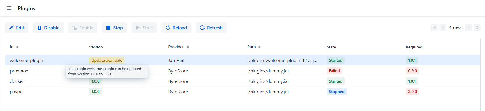
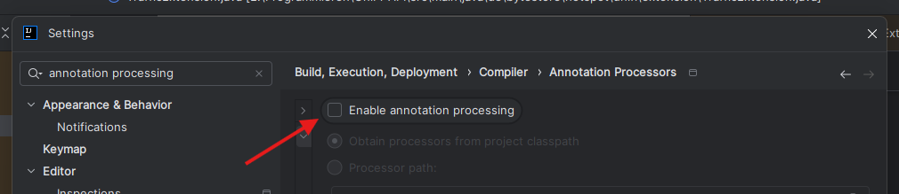
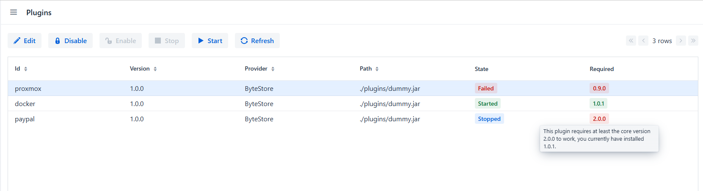
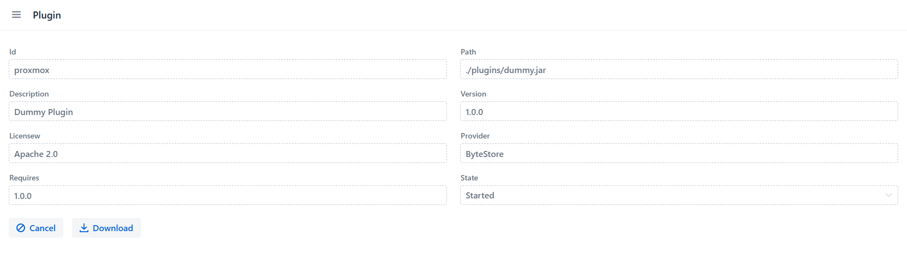

[](https://github.com/Gamer08YT/jmix-plugin-addon/actions/workflows/release.yml) [](https://github.com/Gamer08YT/jmix-plugin-addon/actions/workflows/test.yml)

# Jmix Plugin Addon

The Jmix Plugin Addon allows you to write your own plugins for [Jmix](https://jmix.io/) that are not anchored in the
source code, but are
injected via [PF4J](https://pf4j.org/).

The addon allows you to load/unload and enable/disable or update plugins via your own plugin repository.



## Manual Installation

The following table lists the add-on versions compatible with different Jmix platform versions:

| Jmix Version | Add-on Version | Dependency (Gradle Implementation) |
|--------------|----------------|------------------------------------|
| 2.4.2        | 1.3.1          | de.bytestore:plugin-starter:1.3.1  |
| 2.4.3        | 1.3.6          | de.bytestore:plugin-starter:1.3.6  |
| 2.5.0-RC1    | 1.4.0          | de.bytestore:plugin-starter:1.4.0  |
| 2.6.0-RC1    | 2.6.0          | de.bytestore:plugin-starter:2.6.0  | 
| 2.6.1        | 2.6.1          | de.bytestore:plugin-starter:2.6.1  | 
| 2.7.0        | 2.7.0          | de.bytestore:plugin-starter:2.7.0  | 
| 2.8.0        | 2.8.0          | de.bytestore:plugin-starter:2.8.0  |
| 3.0.0        | 3.0.0          | de.bytestore:plugin-starter:3.0.0  | 
| 3.0.3        | 3.0.3          | de.bytestore:plugin-starter:3.0.3  | 
| 3.1.0        | 3.1.0          | de.bytestore:plugin-starter:3.1.0  |

1. Add Maven Dependencies to your `build.gradle`:
    ```groovy
    implementation 'de.bytestore:plugin-starter:<addon-version>' 
    ```
2. Make sure to replace `<addon-version>` with the compatible version mentioned in the table above.

## JPA

To access JPA Objects you need to implement the Eclipse Persistence Lib otherwise you get an Error.

```groovy
compileOnly 'org.eclipse.persistence:org.eclipse.persistence.jpa'
```

## Provided Views

The Add-on comes with 4 included Views.

- PluginListView [/plugins]
- PluginDetailView [/plugins/{id}]
- RepositoryListView [/repositories]
- RepositoryDetailView [/repositories/{id}]

## Features

- Plugin Management (Disable/Enable/Start/Stop/Delete/Download/Update)
- Version Management ([Semver](https://semver.org/))
- Plugin [Development Mode](https://pf4j.org/doc/development-mode.html) (Load Modules from Sourcecode and not JAR
  Archive)
- Local Plugin Repositories
- Remote Plugin Repositories
- Per-plugin changelog and About tabs on the plugin detail view

### Plugin Changelog

Add `plugin-changelog.json` to the root of the plugin JAR resources. It must contain a JSON array, newest entry first:

```json
[
  {
    "version": "1.2.0",
    "date": "2026-10-16",
    "changes": ["Added feature X", "Fixed issue Y"]
  }
]
```

The detail view reads the file directly from the plugin JAR and displays each version, date, and change. The file is
optional; the tab is still shown when a plugin has no changelog.

### Plugin About Tab

Implement `PluginAboutExtensionPoint` in a plugin to provide the contents of its About tab. Return Jmix Flow UI
components (Jmix UI components are Vaadin components) from `render()`:

```java
@Extension
public class AboutExtension implements PluginAboutExtensionPoint {
    @Override
    public List<Component> render() {
        return List.of(new H3("My Plugin"), new Paragraph("Plugin information"));
    }
}
```

The About tab is available for every plugin. If no extension is registered, the add-on displays an explanatory note.

### Installation Terms

A plugin can request acceptance of its terms before installation by adding `plugin-terms.html` to the root of its JAR.
After archive validation, the add-on opens a scrollable dialog with that HTML and requires the user to check the
acceptance box before the JAR is moved into the installed plugin directory. Canceling removes the staged archive.
The terms file is optional; plugins without it install through the existing flow. For custom dialog content, implement
`PluginInstallationTermsExtensionPoint` and return Jmix Flow UI components. The extension can also override `title()`.
When this extension is present, it takes precedence over `plugin-terms.html`; the add-on still provides the required
acceptance checkbox and the cancel/continue buttons.

Acceptance is stored for the exact plugin JAR. A changed or updated JAR therefore requires acceptance again. The
add-on checks this before manual starts, automatic startup, and plugin reload; an unaccepted plugin remains stopped.

```java
@Extension
public class InstallationTerms implements PluginInstallationTermsExtensionPoint {
    @Override
    public String title() {
        return "License terms";
    }

    @Override
    public List<Component> render() {
        return List.of(new H3("Before you install"), new Paragraph("Your plugin-specific terms go here."));
    }
}
```

### Create Plugin Repository

A Plugin Repository is simply a JSON Array with the Definition of the Plugin Versions, for example, `plugins.json`:

```json
[
  {
    "id": "welcome-plugin",
    "description": "Welcome plugin",
    "releases": [
      {
        "version": "1.8.1",
        "date": "2024-06-05T21:00:35",
        "url": "../../../../welcome-plugin/build/libs/welcome-plugin-1.8.1.jar"
      },
      {
        "version": "1.8.0",
        "date": "2024-06-01T20:10:21",
        "url": "../../../../welcome-plugin/build/libs/welcome-plugin-1.8.0.jar"
      }
    ]
  }
]
```

### Local Repository URI:

A local Repository could be a JSON File on your machine.

```file:/home/jaxnprivate/work/jmix-plugin-addon/resources/```

### Remote Repository URI:

A remote Repository could be a JSON File or a Route with an JSON Object on a Webserver.

```http://plugins.byte-system.de/```

### Plugin Auto-loading

To disable Plugin Auto-loading, you need to add this line to your `application.properties`.

You than can control the loading via the `PluginService`.

```properties
plugins.autoload=false
```

### Change Plugin Directory

To change Plugin Directory, you need to add this line to your `application.properties`.

```properties
plugins.home=./test/plugins
```

### Semantic Version Check

To disable globally semantic version checking, you need to add this line to your `application.properties`.

This will hide the required Field in the List UI and disables Version checking via PF4J.

```properties
plugins.version.check=false
```

### Exact Version Check

To enable exact version checks, you need to add this line to your `application.properties`.

```properties
plugins.version.exact=true
```

## Troubleshooting:

No Extensions getting found?

Please enable Annotations for your Project. see [PF4J Troubleshooting](https://pf4j.org/doc/troubleshooting.html)



If you use Gradle please add following, to your ``build.gradle``.

```groovy
annotationProcessor(group: 'org.pf4j', name: 'pf4j', version: "<pf4jVersion>")
``` 

## Screenshots






Shield: [![CC BY-NC 4.0][cc-by-nc-shield]][cc-by-nc]

This work is licensed under a
[Creative Commons Attribution-NonCommercial 4.0 International License][cc-by-nc].

[![CC BY-NC 4.0][cc-by-nc-image]][cc-by-nc]

[cc-by-nc]: https://creativecommons.org/licenses/by-nc/4.0/

[cc-by-nc-image]: https://licensebuttons.net/l/by-nc/4.0/88x31.png

[cc-by-nc-shield]: https://img.shields.io/badge/License-CC%20BY--NC%204.0-lightgrey.svg
